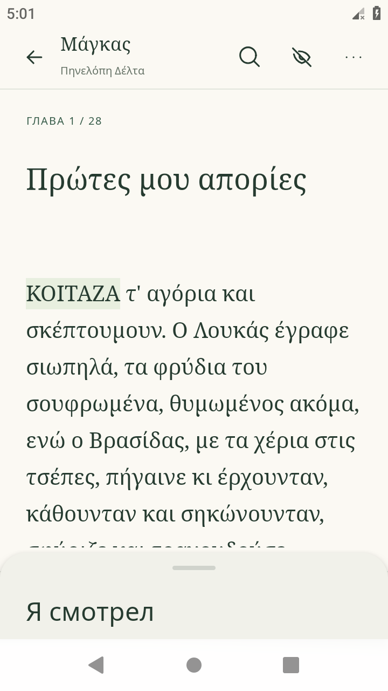
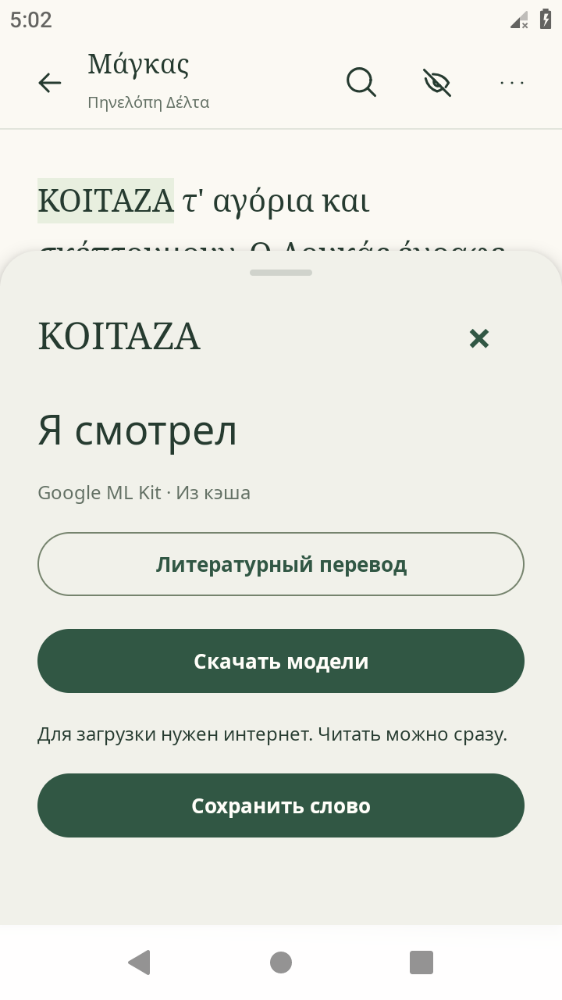

# Компактная карточка перевода — 0.1.6

По умолчанию карточка показывает только русский перевод и ручку для раскрытия.
Минимальная высота — 80 dp; для длинного перевода или увеличенного системного
шрифта она растёт. В компактном виде помещаются до трёх строк. Пока перевод
не готов, на его месте отображается короткий статус.

- Потяните карточку вверх или нажмите ручку: откроются выбранное слово,
  источник перевода, литературный перевод, сохранение и перевод предложения.
- Потяните ручку или заголовок вниз: карточка свернётся. Содержимое расширенной
  карточки прокручивается независимо.
- В компактном виде движение вниз закрывает карточку. Касание вне карточки
  и кнопка закрытия в раскрытом виде тоже работают.
- Для каждого нового выбранного слова начальное состояние снова компактное.
- Исходное греческое предложение не выводится в карточке ни в одном состоянии.
  Русский литературный или машинный перевод предложения доступен после раскрытия.
- Если нужны языковые модели, согласие и кнопка загрузки находятся в расширенном
  виде; модели загружаются после действия пользователя.

## Продолжение разработки

Новый компонент написан в Kotlin/Compose: `ui-src/CompactWordSheet.kt`.
Компиляция описана в `ui-src/README.md`. API-заглушки нужны только компилятору;
они не включаются в APK и не заменяют модели данных или ViewModel приложения.
У `WordSelection` в заглушке намеренно нет `getContext()`: источник предложения
недоступен этому компоненту для отображения.

В `ReaderScreenKt$ReaderScreen$3.smali` ветви Translation и Consent вызывают
новый компонент. Остальные панели используют восстановленную реализацию.
Компонент передаёт высоту и границы карточки прежнему контейнеру читалки,
чтобы выбор слова и обработка касаний вне карточки продолжали работать.
Контрольные суммы в `ui-src/compiled.json` проверяются при сборке.

## Проверка

На Android 9 / x86 проверены компактный перевод, жесты раскрытия и сворачивания,
перевод другого слова в компактном виде, сохранение слова в базу, закрытие
касанием вне карточки и литературный перевод офлайн. Установка поверх прежнего
приложения сохранила позицию чтения. В logcat не зафиксировано ошибок AndroidRuntime.

Для успешного машинного перевода использован контролируемый кэш только в
эмуляторе; загрузка моделей через интернет и физические ARM-устройства в этом
прогоне не проверялись. Снимки экрана сделаны из подписанного x86 APK.
Новые книжные тексты не добавлялись: все 36 исходных файлов assets побайтово
совпадают с исходным APK во всех четырёх вариантах. Отчёт: `releases/0.1.6.json`.
